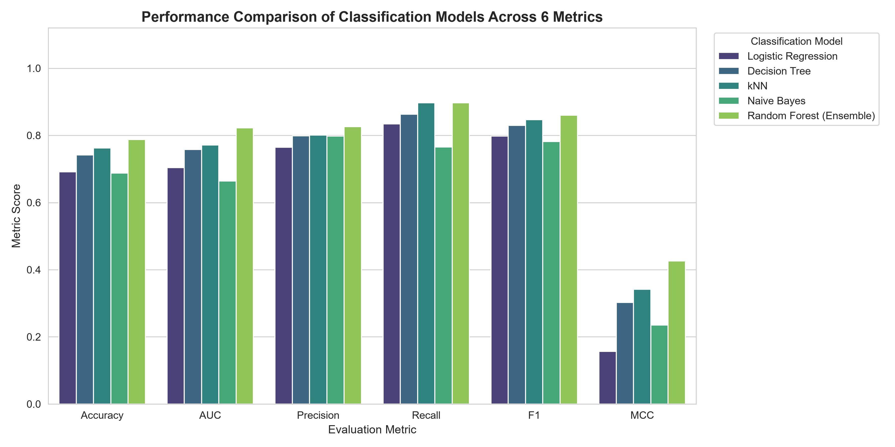
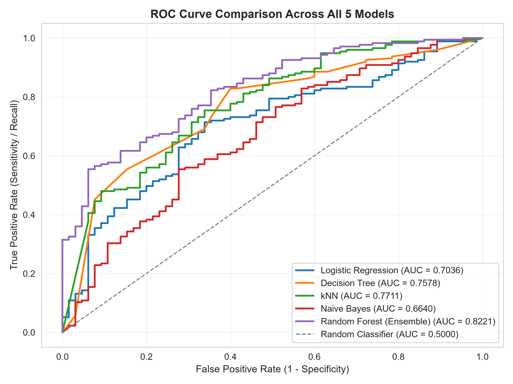

# Garment Employees Productivity Classification — ML Assignment 2

**Student Name:** Viswanadha Tarun  
**Program:** M.Tech (AIML / DSE) — Work Integrated Learning Programmes (WILP), BITS Pilani  
**GitHub Repository:** [https://github.com/nikhil2004-vis/ml-assignment-2](https://github.com/nikhil2004-vis/ml-assignment-2)

---

## 1. Problem Statement

Garment manufacturing relies heavily on manual labor and tightly coordinated production lines across sewing and finishing departments. Predicting whether a production team will meet or exceed its daily targeted productivity enables floor managers to proactively allocate overtime, adjust incentives, and resolve bottlenecks before delays cascade.

This project formulates a **binary classification pipeline** to predict whether a garment production team meets its daily productivity target (`target_met = 1` when `actual_productivity >= targeted_productivity`, and `0` otherwise) using operational, staffing, and temporal attributes, and systematically benchmarks five distinct supervised classification algorithms across six evaluation metrics.

---

## 2. Dataset Description

* **Dataset Name:** Productivity Prediction of Garment Employees
* **Public Source:** [UCI Machine Learning Repository (ID: 597)](https://archive.ics.uci.edu/dataset/597/productivity+prediction+of+garment+employees)
* **Selection Rationale:** The dataset exceeds all assignment criteria (1,197 instances vs. 1,000 minimum; 15 input features vs. 12 minimum), contains genuine real-world missingness in work-in-progress records, exhibits realistic operational class imbalance, and blends mixed numerical and categorical variables requiring structured preprocessing.
* **Dataset Dimensions:**
  * **Total Instances:** 1,197 records (0 duplicate rows found)
  * **Input Features:** 15 features after extracting `month` and `day_of_month` from `date` and dropping the raw continuous `actual_productivity` column used to derive the target
  * **Train / Test Split:** 80:20 stratified split (`957` training instances, `240` test instances saved in `test_data.csv`) using `random_state=42`
* **Feature Breakdown:**
  * **Categorical Features (4):** `quarter` (Quarter1–Quarter5), `department` (`sweing`, `finishing` after whitespace normalization), `day` (day of the week), `team` (team identifier 1–12).
  * **Numerical Features (11):** `targeted_productivity`, `smv` (Standard Minute Value), `wip` (Work in Progress), `over_time` (in minutes), `incentive`, `idle_time`, `idle_men`, `no_of_style_change`, `no_of_workers`, `month`, `day_of_month`.
* **Missing Values Handling:**
  * `wip` (Work in Progress) contained **506 missing values** (~42.3% of records, occurring primarily in finishing lines where unfinished items are not logged separately).
  * Imputed using **median imputation** (`SimpleImputer(strategy="median")`) fitted **strictly on the training set** to prevent data leakage, alongside `most_frequent` imputation for categorical attributes.
* **Target Variable & Class Distribution:**
  * **Class `1` (Met Target):** 875 instances (**73.10%**)
  * **Class `0` (Missed Target):** 322 instances (**26.90%**)
  * Stratified splitting preserved this exact ~73.1% / 26.9% class ratio across both training and test sets, and **Matthews Correlation Coefficient (MCC)** and **ROC-AUC** were included alongside Accuracy to fairly evaluate performance under class imbalance.

---

## 3. GitHub Repository Structure & Execution Instructions

### Repository Layout
    ml-assignment-2/
    ├── requirements.txt
    ├── README.md
    ├── test_data.csv
    └── model/
        ├── preprocess.py
        ├── train_evaluate.py
        ├── evaluation_results.csv
        ├── metrics_comparison.png
        ├── roc_curves.png
        └── saved_models/
            ├── logistic_regression.pkl
            ├── decision_tree.pkl
            ├── knn.pkl
            ├── naive_bayes.pkl
            └── random_forest_ensemble.pkl

### Execution Instructions
    # 1. Clone the repository
    git clone https://github.com/nikhil2004-vis/ml-assignment-2.git
    cd ml-assignment-2

    # 2. Install required dependencies
    pip install -r requirements.txt

    # 3. Run leakage-free preprocessing and generate stratified test_data.csv
    python model/preprocess.py

    # 4. Train all 5 models, evaluate metrics, save artifacts, and generate plots
    python model/train_evaluate.py

---

## 4. Models Used & Evaluation Comparison Table

All five classification models were trained using identical leakage-free preprocessing pipelines (`StandardScaler` + median imputation for numerical features; `OneHotEncoder(handle_unknown="ignore")` + mode imputation for categorical features fitted exclusively on the 80% training split) and evaluated on the unseen 20% test set (`240` samples):

| ML Model Name | Accuracy | AUC | Precision | Recall | F1 | MCC |
| :--- | :---: | :---: | :---: | :---: | :---: | :---: |
| **Logistic Regression** | 0.6917 | 0.7036 | 0.7644 | 0.8343 | 0.7978 | 0.1565 |
| **Decision Tree** | 0.7417 | 0.7578 | 0.7989 | 0.8629 | 0.8297 | 0.3023 |
| **kNN** | 0.7625 | 0.7711 | 0.8010 | 0.8971 | 0.8464 | 0.3413 |
| **Naive Bayes** | 0.6875 | 0.6640 | 0.7976 | 0.7657 | 0.7813 | 0.2353 |
| **Random Forest (Ensemble)** | **0.7875** | **0.8221** | **0.8263** | **0.8971** | **0.8603** | **0.4262** |

---

## 5. Graphical Representation of Evaluation Metrics

### Comparison Across All 6 Metrics

### ROC Curve Comparison

---

## 6. Model Performance Observations

| ML Model Name | Observation about model performance |
| :--- | :--- |
| **Logistic Regression** | Achieved moderate discrimination (`AUC = 0.7036`) and high Recall (`0.8343`), but yielded the lowest MCC (`0.1565`) and Accuracy (`0.6917`). Because productivity thresholds depend on non-linear interactions between `smv`, `incentive`, `no_of_workers`, and `department`, a linear decision boundary underfits the minority class (`Missed Target`), producing more false positives. |
| **Decision Tree** | Improved substantially over Logistic Regression across every metric (`Accuracy = 0.7417`, `AUC = 0.7578`, `MCC = 0.3023`). Using `max_depth=6` and `min_samples_leaf=5` allowed the tree to capture non-linear threshold rules (such as incentive cutoffs and style changes) while controlling variance, nearly doubling the MCC score. |
| **kNN** | Ranked second overall (`Accuracy = 0.7625`, `AUC = 0.7711`, `F1 = 0.8464`, `MCC = 0.3413`) and tied for the highest Recall (`0.8971`). Distance-weighted voting (`n_neighbors=7`) on standardized features effectively grouped similar team/SMV/overtime operating profiles, though high dimensionality from one-hot encoded teams slightly tempered its precision (`0.8010`). |
| **Naive Bayes** | Recorded the lowest Accuracy (`0.6875`), AUC (`0.6640`), and Recall (`0.7657`), though its Precision (`0.7976`) and MCC (`0.2353`) outperformed Logistic Regression. Gaussian Naive Bayes assumes conditional feature independence and normality, which is violated by correlated manufacturing variables (`smv`, `no_of_workers`, `over_time`) and binary one-hot indicators. |
| **Random Forest (Ensemble)** | Delivered the strongest performance across every single metric (`Accuracy = 0.7875`, `AUC = 0.8221`, `Precision = 0.8263`, `Recall = 0.8971`, `F1 = 0.8603`, `MCC = 0.4262`). Bagging 200 depth-regularized trees reduced single-tree variance and captured complex feature interactions without overfitting, achieving the best balance between majority and minority class predictions. |
| **Overall Winner for your dataset?** | **Random Forest (Ensemble)** is the clear overall winner, ranking #1 across all six evaluation metrics—most notably achieving an **AUC of 0.8221** and an **MCC of 0.4262** (more than 2.7x higher than Logistic Regression), demonstrating superior predictive power on imbalanced operational data. |